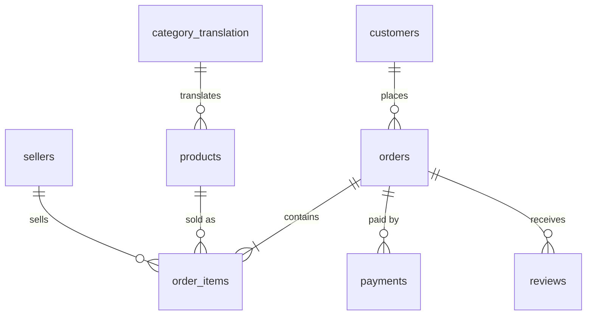
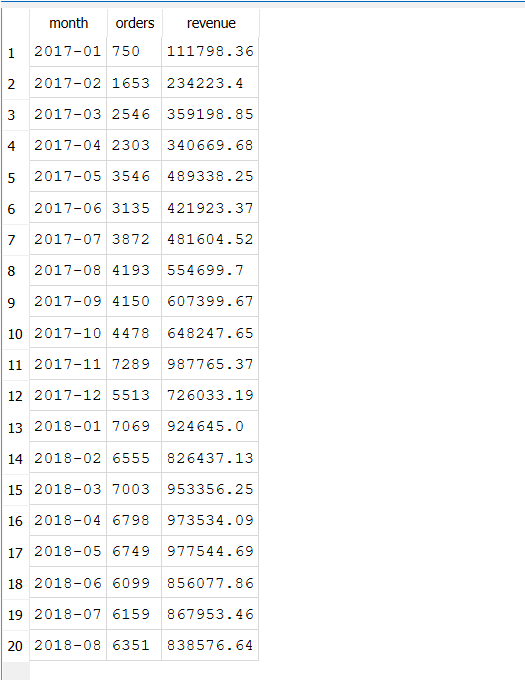
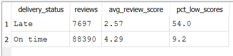
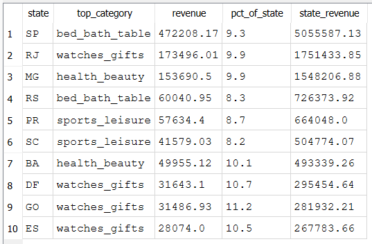

# Olist E-Commerce SQL Analysis

A SQL analysis of a Brazilian online marketplace: revenue trends, product categories, regions, payments, delivery performance, customer reviews and retention. Written in SQLite, using JOINs across 6 tables, CTEs and window functions.

## Business Problem

An online marketplace wants to know where its revenue comes from, how well it delivers, and whether customers come back. This project answers 10 business questions with SQL, from simple aggregations to window functions.

## Dataset

- **Source:** Kaggle, "Brazilian E-Commerce Public Dataset by Olist" https://www.kaggle.com/datasets/olistbr/brazilian-ecommerce
- **Size:** about 99,000 orders, 112,000 order items, 103,000 payments, 99,000 reviews, 33,000 products and 3,100 sellers, spread across 8 related tables
- **Period in the data:** Sep 2016 to Oct 2018
- **Analysis window:** Jan 2017 to Aug 2018 (20 full months), delivered orders only (see Limitations)
- **Currency:** Brazilian reais

## Database Structure

## Tools and SQL Skills

SQLite and DB Browser for SQLite.
- JOINs across up to 4 tables, including LEFT JOIN
- Aggregations: GROUP BY, COUNT DISTINCT, SUM, AVG
- CTEs (WITH), including two chained CTEs
- Window functions: SUM OVER, LAG, running totals, RANK with PARTITION BY
- CASE expressions, date functions and a view

## Data Preparation

- Imported 8 CSV files into SQLite and renamed the tables.
- Checked row counts, order statuses, date range, missing delivery dates and data types (prices imported as numbers).
- Created a view `delivered_orders` and used delivered orders only (97% of all orders). Canceled, unavailable and in-progress orders earn no revenue.
- Defined revenue as `SUM(order_items.price)`. Freight is excluded.
- Checked orders per month. Sep to Dec 2016 and Sep to Oct 2018 have very few orders, so trends use Jan 2017 to Aug 2018.
- Used `customer_unique_id` to identify real customers, since `customer_id` changes with every order.

## Key Findings

1. **Revenue growth:** monthly revenue grew from about 111,800 (Jan 2017) to about 924,600 (Jan 2018). The peak was Nov 2017 at about 987,800 (52% above October), probably a Black Friday effect, followed by a 26% drop in December. Total revenue was about 13.18 million from 96,211 orders (average order about 137).
2. **Categories:** health & beauty leads (about 1.23 million, 9.3%), then watches & gifts (8.8%) and bed, bath & table (7.8%). The top 10 of about 70 categories bring in 62.5% of revenue. Watches & gifts earns about 212 per order, against about 110 for bed, bath & table.
3. **Regions:** São Paulo (SP) generates 38.4% of revenue, and SP, RJ and MG together 63.4%. The top 10 states make up about 88%.
4. **Payments:** credit cards account for 78.5% of the money paid, boleto (bank slip) for 18.0%, vouchers for 2.2% and debit cards for 1.4%. Credit card customers use 3.5 installments on average.
5. **Delivery:** average delivery time fell from about 12.6 days to 7.7 days. Late deliveries (after the estimated date) spiked in Nov 2017 (14.3%), Feb 2018 (16.0%) and Mar 2018 (21.4%).
6. **Late delivery and reviews:** late orders averaged a review score of 2.57 against 4.29 for on-time orders, and 54.0% of late orders got 1 or 2 stars, against 9.2% for on-time orders. Only about 8% of orders were late.
7. **Sellers:** revenue is spread out. The top seller holds 1.7% and the top 10 sellers 13.3%. Nine of the top 10 are in São Paulo.
8. **Retention:** 97.0% of customers ordered only once, 2.8% twice and 0.2% three or more times.
9. **Growth trend:** after March 2018, revenue stalled in a band of about 838,000 to 978,000, and August 2018 was 14% below the May peak.
10. **Regional taste:** the top category differs by state. Watches & gifts leads in 4 of the top 10 states, and São Paulo is led by bed, bath & table. In every state the top category holds only 8% to 11% of revenue.

### Query results

## Recommendations

- **Reduce late deliveries or set more realistic delivery estimates.** Late orders are linked to far worse reviews, and the spikes in Nov 2017 to Mar 2018 are worth investigating.
- **Work on repeat purchases.** With 97% one-time buyers, a small improvement in retention would be a large relative gain.
- **Look into the slowdown after March 2018** and the drop from the May peak.
- **Tailor promotions by region.** The best category differs by state, and São Paulo, RJ and MG matter most.
- **Keep installment options for credit cards**, which most customers use.

## Limitations

- Only delivered orders are analysed. Delivery-time figures for the most recent months may look better than reality, because slow orders still in transit are not counted.
- The dataset has very few orders in late 2016 and in Sep to Oct 2018, so those months were left out of the trends.
- Revenue excludes freight, but payment totals include it, so those figures are not directly comparable. Category and payment order counts can overlap, because one order can include several categories or payment methods.
- The link between late delivery and low reviews does not prove that lateness causes the low scores.
- Recent first-time customers had little time to come back, so the repeat rate may be understated.
- The geolocation file was not used.

## How to Reproduce

1. Download the dataset from Kaggle and import the 8 CSV files (all except geolocation) into SQLite, for example with DB Browser for SQLite.
2. Rename the tables to `customers`, `orders`, `order_items`, `payments`, `reviews`, `products`, `sellers` and `category_translation`.
3. Run the queries in `queries.sql`.

## Files

- `queries.sql`: all 10 queries, with comments
- `Images/`: screenshots of selected results

## About Me

Baladharshini | Aspiring Data Analyst | SQL, Excel, Power BI

LinkedIn: https://www.linkedin.com/in/baladharshini-s-00420b269
